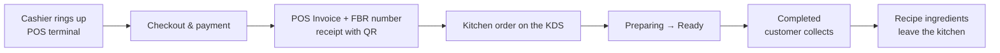
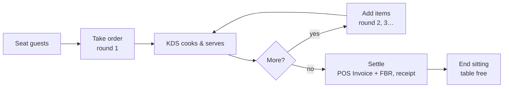
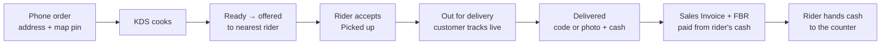
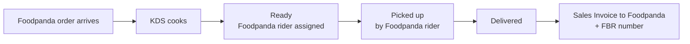

# How orders are invoiced and delivered

This guide follows every kind of order through Restaurant OS: when the kitchen sees it, when the invoice is made, how it
reaches the customer, and where the money and stock go. The last section lists the documents and settings behind each step.

| Order | Invoice made | Who takes the money | Invoice type |
|---|---|---|---|
| Counter (walk-in / takeaway) | At checkout, **before** cooking | Cashier | POS Invoice |
| Dine-in (table) | At **Settle**, after eating | Cashier | POS Invoice |
| Delivery by own rider | When **Delivered** | Rider (cash on delivery) → counter | Sales Invoice |
| Foodpanda | When **Delivered** | Foodpanda (pays the restaurant later) | Sales Invoice to "Foodpanda" |

Every invoice gets sales tax (Restaurant Settings), the FBR POS fee and an FBR invoice number, printed with its QR code.

---

## 1. Counter sale (walk-in / takeaway)

1. The cashier adds dishes in the **POS terminal**. Offers apply on their own (e.g. a free raita with karahi) and coupons can
   be entered. Sold-out dishes are locked.
2. **Checkout**: the customer pays (Cash, Card or Bank Transfer). The **POS Invoice** is saved, reported to FBR, and the
   receipt prints with the FBR number and QR code.
3. The invoice **opens a kitchen order** automatically. It appears on the **KDS** in *Placed*, each dish routed to its
   station (Grill, Handi, Drinks…).
4. The kitchen moves it **Placed → Preparing → Ready → Completed** by tapping the card.
5. At *Completed* the recipe ingredients are deducted from the kitchen stock (background job).

The money is already in the drawer from step 2, so finishing the order only closes the kitchen side. At the end of the
shift, **Close shift** counts the drawer and merges the shift's POS Invoices into Sales Invoices.

## 2. Dine-in (table map)

1. **Table Map → Seat guests** on a free table. It turns green with a timer and the guest count.
2. **Take order**: the dishes go to the KDS (no invoice yet). Each later **Add items** is a new round; the KDS shows it as
   *+ New Items* above *Already Ordered*.
3. The kitchen cooks and serves. Ingredients are deducted as each round is completed.
4. **Print Bill** gives a pre-bill (not a tax receipt).
5. **Settle**: choose the payment mode and amount. The **POS Invoice** is created for everything the table ordered, with
   offers, tax and the FBR number, and the receipt prints. It is linked to the table's order, so nothing is cooked twice.
6. **End sitting** frees the table. It is refused until the table is settled.

**Move** shifts a sitting (and its order) to another free table.

## 3. Delivery by your own riders

1. **Dispatch & Riders → Phone order**: customer name, phone, address (pin it on the map) and the dishes. It goes to the
   kitchen as **cash on delivery**; the amount to collect is worked out with tax.
2. The customer can be sent the **tracking link**: progress steps, the rider on the map, ETA, and a **4-digit delivery code**.
3. The kitchen cooks it on the KDS. At **Ready** it is offered to a rider, following Restaurant Settings → Rider Assignment:
   - **Auto – Nearest**: the available rider closest to the branch;
   - **Auto – Least Busy**: the rider with the fewest deliveries in hand;
   - **Manual**: it waits on the dispatch map for a manager to assign it.

   If a rider declines, it is offered to the next one.
4. The rider uses the **rider app** (`/ros/rider`): accept, call the customer, open the route in Google Maps, then
   **Picked up**. The order becomes *Out for Delivery* and the ingredients leave the kitchen. The rider's GPS is sent while
   on duty and shows on the dispatch map and the customer's tracking page.
5. **Delivered**: the rider enters the customer's delivery code (or takes a photo, unless the code is required) and the
   cash collected. Then:
   - the **Sales Invoice** is created to the customer, with tax and the FBR number;
   - the cash is booked as a payment against that invoice into the **Rider Cash** account, so the invoice is paid and the
     rider's *cash in hand* goes up.
6. **Cash handover**: on the dispatch map, the rider's cash button moves the cash from Rider Cash to the counter's cash.
   If a cashier has an open shift, it is added to that shift's expected cash, so the drawer count at **Close shift** balances.

If the rider couldn't collect (or the cash came in later), the invoice stays open and the cashier can take the money with
**POS → Receive payment**, which pays the customer's oldest open invoice.

## 4. Foodpanda orders

1. The order arrives from Foodpanda (in **Mock** mode the ⚡ button on the KDS or dispatch map simulates one). It appears on
   the KDS as an amber **Delivery** card. **No invoice yet.**
2. The kitchen cooks it. At **Ready**, Foodpanda assigns its rider; the rider's name, status and position come from
   Foodpanda and show on the dispatch map (pink) and the customer's tracking page.
3. Tap the card when the Foodpanda rider collects it: **Picked Up**. The ingredients leave the kitchen.
4. Tap again when delivered: **Delivered**. The **Sales Invoice** is created to the customer **"Foodpanda"** at the
   Foodpanda price list, with tax and the FBR number. It stays open as an amount Foodpanda owes; record Foodpanda's
   payout against it when it arrives. An order cancelled before delivery never reaches the books.

To deliver Foodpanda orders with your **own riders** (Foodpanda's restaurant-delivery mode), set Restaurant Settings →
Foodpanda → *Delivered By* = **Own Rider**. Those orders then follow section 3 (assignment, rider app, tracking), but are
still invoiced to Foodpanda when delivered.

## 5. Returns and cancellations

- **Counter / dine-in return**: POS → Return invoice (whole or part). The refund goes through the chosen payment mode in the
  current shift and is reported to FBR as a credit invoice.
- **Cancelling an invoice** cancels its kitchen order and reverses any ingredients already issued.
- A **delivery cancelled before delivery** is never invoiced.

## 6. Where to see it

| Screen | What it shows |
|---|---|
| POS terminal `/ros/pos/terminal` | Counter sales, held sales, returns, cash in/out, shift close |
| Table Map `/ros/pos/tables` | Dine-in sittings, rounds, settle, move, end sitting |
| Kitchen Display `/ros/kds` | Every order from every channel, status columns, sold-out ("86") list |
| Dispatch & Riders `/ros/dispatch` | Riders and drop-offs on the map, assignment, phone orders, rider cash |
| Rider app `/ros/rider` | The rider's offers and deliveries (phone) |
| Tracking page `/ros/track/<code>` | The customer's view (public link) |
| POS Invoices / Sales Invoices | All invoices, with their FBR number |
| Orders | Every Restaurant Order with its invoice, rider and stock status |

---

## Reference: documents and settings

### Documents

| Step | Document | Notes |
|---|---|---|
| Kitchen order (every channel) | **Restaurant Order** | Status, items with station and kitchen status, invoice link, rider, delivery address, tracking key, delivery code |
| Counter / dine-in sale | **POS Invoice** (POS Awesome shift on it) | Merged into a Sales Invoice when the shift closes |
| Delivery / Foodpanda sale | **Sales Invoice** | Outside the cashier's shift; reported to FBR |
| Rider job | **Delivery Assignment** | Offered → Accepted → Picked Up → Delivered (or Rejected / Cancelled); proof, cash collected |
| Rider's GPS | **Rider Location Log** | Kept 7 days |
| Cash on delivery | **Payment Entry** into *Rider Cash* | Against the delivery invoice |
| Rider cash handover | **Journal Entry** Rider Cash → counter cash | Tagged with the cashier's open shift |
| Ingredients used | **Stock Entry** (Material Issue, source "Recipe") | From the branch kitchen, per order line |
| FBR call | **Integration Request** | Every report to FBR, also in Mock mode |

### Order status by type

| Type | Statuses |
|---|---|
| Counter / dine-in | Accepted (Placed) → Preparing → Ready → Completed |
| Delivery, own rider | Accepted → Preparing → Ready → Picked Up → Out for Delivery → Delivered |
| Delivery, Foodpanda rider | Accepted → Preparing → Ready → Picked Up → Delivered |
| Any | Cancelled (invoice cancelled) |

Ingredients are deducted at **Completed** or **Picked Up** (Restaurant Settings → Deduct Ingredients can move this to
invoice submit). The deduction is per order line, so later dine-in rounds are deducted too.

### Settings that change these flows (Restaurant Settings)

| Setting | Effect |
|---|---|
| Counter Sales Posted As | POS Invoice (default) or Sales Invoice for counter and dine-in sales |
| Apply Sales Tax / rate / Menu Prices | Tax on every invoice, added on top of or included in the price |
| Report Sales to FBR / Mode / POS fee | FBR number and QR on receipts; Mock until registered |
| Payment Modes | Order offered at the counter (Cash, Card, Bank Transfer) |
| Rider Assignment | Auto – Nearest, Auto – Least Busy or Manual |
| Rider Must Enter the Delivery Code | Else a photo is enough proof |
| Rider Cash Account | Where cash on delivery is held until handover |
| Average Rider Speed | For the customer's ETA |
| Foodpanda Orders Delivered By | Foodpanda Rider (default) or Own Rider |
| Invoice Foodpanda Orders To | The customer Foodpanda invoices go to |
| Deduct Ingredients | On order completion (default) or on invoice submit |
| Block Sold-out Items | Refuse dishes the kitchen can't make |

### Code

| Area | File |
|---|---|
| Counter sales, shifts, returns, cash | `restaurant_os/api/pos.py` |
| Order state machine, invoice → order link | `restaurant_os/services/orders.py` |
| Delivery invoice, dispatch steps | `restaurant_os/services/delivery.py` |
| Riders, assignment, cash on delivery, tracking positions | `restaurant_os/services/riders.py`, `restaurant_os/api/riders.py` |
| Dine-in | `restaurant_os/api/tables.py` |
| KDS actions | `restaurant_os/api/kds.py` |
| Recipe stock deduction | `restaurant_os/services/stock_deduction.py` |
| FBR | `restaurant_os/integrations/tax_authority/fbr.py` |
| Foodpanda | `restaurant_os/integrations/aggregators/foodpanda.py` |
